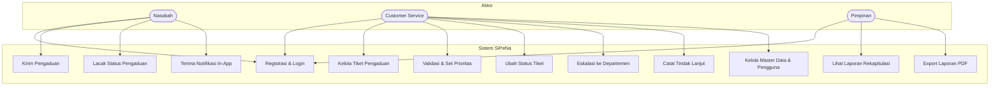
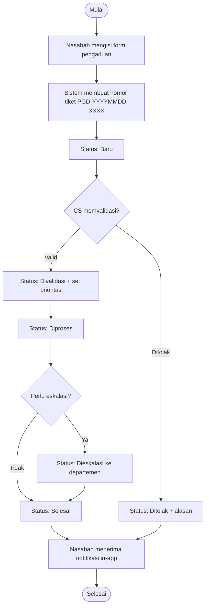
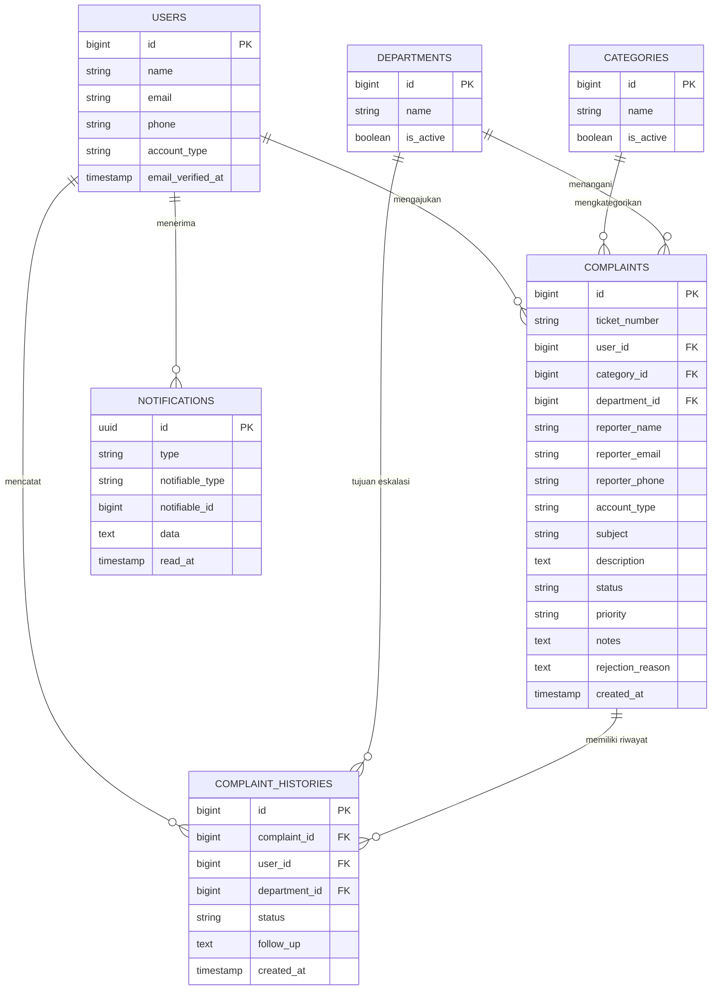
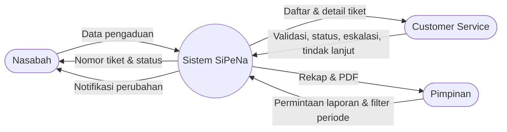
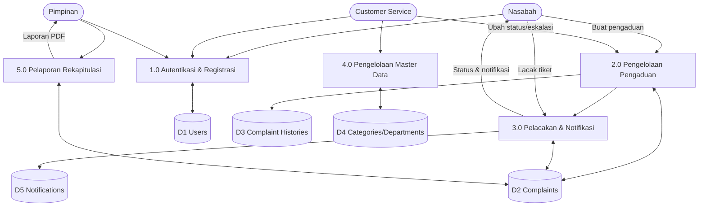

# Diagram SiPeNa — Sistem Informasi Pengaduan Nasabah

Dokumen ini memuat diagram perancangan sistem SiPeNa sesuai 3 role: Nasabah, Customer Service (CS), dan Pimpinan.

---

## 1. Use Case Diagram

---

## 2. Activity Diagram — Alur Pengaduan dari Dibuat hingga Ditutup

---

## 3. Entity Relationship Diagram (ERD)

---

## 4. Data Flow Diagram (DFD)

### 4.1 DFD Level 0 (Context Diagram)

### 4.2 DFD Level 1

